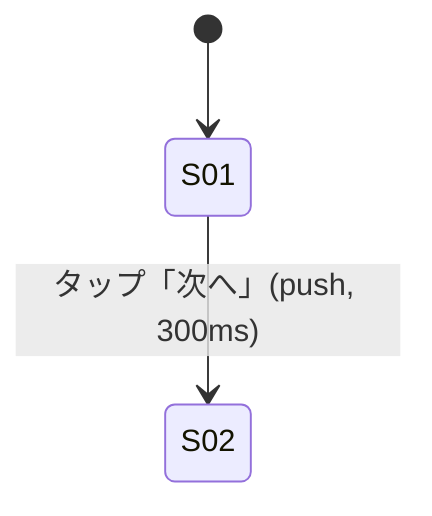

# <競合名> 画面解析

## 画面リスト
| ID | 画面名 | 到達経路 | 録画/フレーム | 状態バリエーション |
|---|---|---|---|---|
| S01 | | | `frames/01/scene/scene-0001.png` (0.0s) | default / empty / loading / error |

## 遷移図

## 画面詳細
### S01 <画面名>
- レイアウト: （ヘッダ / サイドバー / コンテンツ / フッタの構成と寸法）
- 構成要素: 
- インタラクション:
  | トリガー | 反応 | 遷移先/状態 | アニメーション (種類・duration・easing) | 根拠フレーム |
  |---|---|---|---|---|
- 文言の構造（※文言そのものは再現時にダミーへ置換）: 
