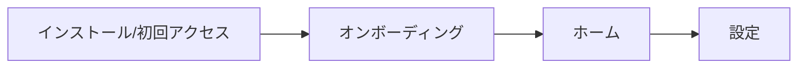

# <競合名> 調査

- 調査日: YYYY-MM-DD
- 対象: Web / Mac / iPhone（該当に印）
- URL / App Store: 

## 概要・ターゲット
- 一言で:
- 主なユーザー:
- 主要ユースケース:

## 料金プラン
| プラン | 価格 | 主な制限 | 根拠URL |
|---|---|---|---|

## 機能一覧
| # | 機能 | 区分 (無料/有料/不明) | 画面・入口 | 根拠URL |
|---|---|---|---|---|

## 全体フロー（オンボーディング → 設定）

## 技術スタックの推察
| レイヤ | 推察 | 根拠 | 確度 (高/中/低) |
|---|---|---|---|
| UI フレームワーク | | | |
| スタイリング | | | |
| 状態管理/データ | | | |
| バックエンド/同期 | | | |
| 配布形態 | | | |

## 再現に使うスタック（決定）
- 採用: 
- 理由: 
- 推察との差分と影響: 
