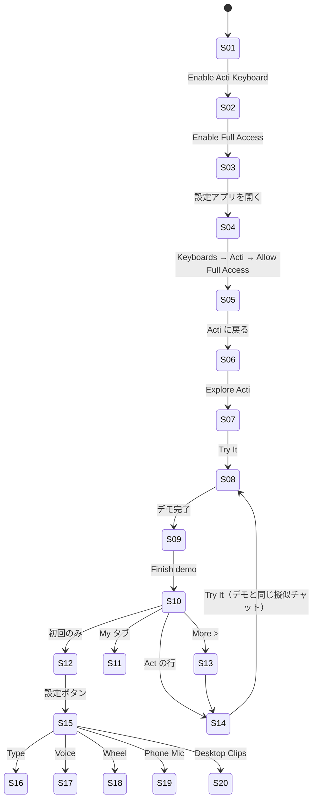

# Acti 画面解析（iPhone）

- 録画: `ScreenRecording_11-09-2026 20-17-50_1.mp4`（rec1）。158秒、1206×2622（402×874pt @3x、iPhone 16 Pro / 17 Pro 相当）、可変フレームレート（最大60fps）、ダークモード
- フレーム: `frames/rec1/`（git 管理外）。時刻は `frames/rec1/index.md` を参照
- 状態: ゲスト（未サインイン）、Free 10/10 クレジット

## 画面リスト
| ID | 画面名 | 到達経路 | 根拠フレーム | 状態バリエーション |
|---|---|---|---|---|
| S01 | イントロ「Your keyboard can Act」 | 初回起動 | interval 0–18s / scene-0001 | 自動再生のキーボードデモ（後述） |
| S02 | Enable Full Access（説明シート） | S01「Enable Acti Keyboard」 | scene-0002, 0007 | 「Your data is safe」カード + Allow Full Access トグルのイラスト |
| S03 | 設定アプリへの誘導アニメーション | S02「Enable Full Access」 | scene-0003, 0004, 0009 | iOS 設定のミニチュアが右上から出て「Keyboards」をタップする手のアニメーション |
| S04 | iOS 設定 > Acti（システム画面） | S02 から設定アプリへ | scene-0005, 0010 | 設定アプリ内に「3 Steps to Set Up Acti AI Keyboard」の説明が表示される |
| S05 | 「Return to Acti to continue setup」 PiP 風ガイド | 設定アプリ上 | scene-0005, 0006 | 設定アプリの上にフロートするガイドカード |
| S06 | Acti keyboard is ready | アプリに戻る | scene-0014 | 緑チェック + 3項目（97 Languages / Free AI Dictation / 5000+ Community Acts）+「Explore Acti」+「Can't Find Acti Keyboard? Watch The Guide」 |
| S07 | Act 紹介（Acti AI） | S06「Explore Acti」 | scene-0016, 0017 | 中央にオーブアイコン、Acti Official（1 Acts）、Act Overview、「Try It」 |
| S08 | インタラクティブデモ（擬似メッセージアプリ） | S07「Try It」 | interval 51–81s, scene-0018, 0019 | James とのチャット。コーチマーク「Hold space bar」「You can also run your Acts here」「Tap to run」→ Acti パネル「Thinking •••」→ 結果を入力欄へ → 送信 |
| S09 | 「Now, try it in your favorite apps」 | S08 完了 | interval 78–81s | WhatsApp / iMessage / Telegram の行（↗）、「Finish demo」 |
| S10 | ホーム（Acts ギャラリー / All） | S09 完了、または通常起動 | scene-0053, 0060 | 上部: 設定・All/My・検索。ヒーロー「Acti AI」、Acti 101 カード、カテゴリチップ、カテゴリ別セクション（横スクロールのカード列）、下部固定「Describe an Act to build...」 |
| S11 | ホーム（My） | S10 の My タブ | scene-0048, 0051 | サブタブ All / Added / Created、並び替えアイコン。追加済みの「Acti AI」 |
| S12 | 初回コーチマーク「More settings here」 | 初回のホーム | scene-0022 | 設定ボタンをハイライトして手のアイコン |
| S13 | カテゴリ一覧（例: Writing） | セクションの「More >」 | scene-0061 | Act の一覧（アイコン・名前・説明 1 行） |
| S14 | Act 詳細 | Act の行をタップ | scene-0064, 0065 | タイトル、作者カード（Follow）、Act Overview、Input & Output、Remix / Add、Try It、右上「…」 |
| S15 | Settings（ルート） | ホームの歯車 | scene-0024, 0025, 0043 | 後述 |
| S16 | Keyboard Settings | Settings > Type | scene-0027〜0030 | 後述 |
| S17 | Voice Settings | Settings > Voice | scene-0031 | 後述 |
| S18 | Acti Wheel 設定 | Settings > Wheel | scene-0033, 0035, 0049 | How it works（アニメーション）+ Manage Wheel（5スロット、中央 Acti AI）「Hold to reorder or remove」 |
| S19 | Phone Mic（Pro 紹介） | Settings > Phone Mic | scene-0038 | 「ACTI Pro / EXCLUSIVE FEATURE」バッジ、図解、Connect in two steps、「Login」 |
| S20 | Desktop Clips（Pro 紹介） | Settings > Desktop Clips | scene-0040 | 同上の構成、「Sign in」 |
| S21 | Settings > Clips / Language / Execution History / Connected Tools / Feedback / Community / About | Settings | **未録画** | — |

## Settings（S15）の構成
1. ヘッダー: ×（閉じる）・「Settings」・右上に QR スキャンアイコン
2. アカウントカード: アバター、「Sign in / Sign in to sync your Acts」、`10 / 10 AI Credits`・「Resets daily」・進捗バー、`ACTI [Free]` と「UPGRADE」ボタン
3. Preferences: Language / Type / Voice / Wheel / Clips
4. Desktop Features（右に「Download」リンク）: Phone Mic / Desktop Clips
5. Activity & Tools: Execution History（Recent Runs）/ Connected Tools
6. Support: Feedback（Help Improve Acti）/ Community / Appearance（Automatic、上下矢印のポップアップ）/ About
7. 「Delete Guest Data」（赤字、説明文つきカード）

## Keyboard Settings（S16）の構成
- Keyboard Size & Position（>）
- Key Label Weight: スライダー（Thin / Default / Regular / SemiBold）
- Always Show Uppercase Keys（OFF）・Character Preview（ON）
- Feedback: Haptic Feedback（OFF）+ 強さスライダー（Low / Medium / High）、Key Sounds（ON）
- Input Assistance: Auto-Capitalization（ON）・"." Shortcut（ON）・Predictive Text・Next-Word Suggestions（ON）
- Gestures & Keys: Slide to Type（ON）・Swipe Up for Numbers（ON）・Space Bar Cursor Control（ON）・Backspace Swipe Acceleration（ON）・Inline Composition（ON）・Emoji Key（ON）・Comma Key（OFF）
- Access: Full Access（Enabled）・Paste Access（>）

## Voice Settings（S17）の構成
- Spoken Languages（Auto-detect >）
- Polishing: 3段階スライダー Raw / Clean / Smart + 現在値の説明文
- Dictation with Emoji（OFF）
- Voice Translate: Translate to（Languages: 2 >）
- Ask AI: Enhanced Command（OFF）

## ホームのカテゴリと Act（S10。文言は再現時にダミーへ置換）
| カテゴリ | 録画で見えた Act の例 |
|---|---|
| Translate | （先頭チップのみ） |
| Writing | 翻訳 / 文体変換 / 文法修正 / ネイティブ風 / X 投稿 / プロンプト改善 |
| Understand | 多言語理解 / やさしく説明 / 要点抽出 |
| Reply | 自然な返信 / 口説き文句 / ビジネス返信 |
| Work | Google Meet リンク / 語学学習 / Notion 保存 |
| Fun | 絵文字変換 / 歌詞生成 / 占い |
| Finance | 銘柄系 3 件 |
| Travel | （見出しのみ） |

各行: 円形アイコン（48pt 前後、パステルの 3D 風）・名前（1行省略）・`11.8K uses`・右に「Add」ピル。1 セクション 3 行のカードが横に並び、横スクロールする。

## 遷移図

## インタラクション
| 画面 | トリガー | 反応 | アニメーション | 根拠 |
|---|---|---|---|---|
| S01 | 自動 | キーボードのデモが約18秒ループ: Wheel 表示 →「One-tap Google meet」→ 入力 →「Text to Emoji」で絵文字化 → Wheel から「Welcome to Acti keyboard」に置換 | 半円 Wheel が下から拡大、オーブが光る | interval 0–18s |
| S02 | ボタン | 設定アプリのミニチュアが右上から拡大して出る | scale + fade、手のアイコンがタップ | scene-0003, 0004 |
| S06 | 表示時 | 緑チェックが出て3項目が並ぶ | — | scene-0014 |
| S07→S08 | Try It | 画面が擬似メッセージアプリに切り替わる | クロスフェード | 50–51s |
| S08 | スペース長押し | 「Hold space bar」のツールチップ、押した位置に手のアイコン | スペースバーが青くハイライト | 54s |
| S08 | Wheel → Acti AI | キーボードが「Acti」パネルに切り替わり「Thinking •••」 | ドットが順に点滅 | 57s |
| S08 | 完了 | 結果テキストが入力欄に入る → 送信すると青い吹き出しに | — | 60–63s |
| S08 | 2回目 | Type / Act トグルの Act 側を指して「You can also run your Acts here」「Tap to run」 | キーボードを暗くしてコーチマーク | 66s |
| S09 | 表示 | 下から中央にカードが出る | 背景ブラー | 78s |
| S10 | 歯車（初回） | 「More settings here」ツールチップ + 手のアイコン | — | scene-0022 |
| S10 | All / My | セグメントがスライド | 選択ピルが横に移動 | scene-0048 |
| S10 | 縦スクロール | ヒーローとチップが上に流れ、カテゴリ見出しが続く。「Describe an Act to build...」は下部固定 | — | scene-0054〜0058 |
| S15 | 表示 | 下からシートで出る（ホームが背面で縮む） | iOS 標準のシート | 89–90s |
| S15→S16 | 行タップ | 右からプッシュ | iOS 標準のプッシュ | 96s |
| S14 | 表示 | 中央に灰色のオーブが出てからコンテンツがフェードイン（読み込み中の表示） | オーブの拡大縮小 | scene-0064 → 0065 |

## 録画の網羅状況
| 計画の項目 | 状況 |
|---|---|
| i01 初回起動・イントロ / i02 キーボード有効化 | ✅ |
| i03 サインアップ / ログイン | ❌（ゲストのまま） |
| i04 ホーム | ✅ |
| i05〜i07 キーボード基本入力・言語・カーソル移動 | ❌（デモ内の擬似キーボードのみ） |
| i08 Wheel / i09 Ask AI | △（デモ内のみ。本物のキーボードでは未録画） |
| i10〜i11 Acts タブ・キー割り当て | ❌ |
| i12〜i14 Voice | ❌ |
| i15〜i17 Acti Agent・連携・Act 編集 | ❌（Act 詳細の表示のみ） |
| i18 Community | △（ホームのギャラリーと Act 詳細のみ。検索・インストール・Remix は未録画） |
| i19 Clips | ❌ |
| i20 Settings 全体 | △（ルート・Type・Voice・Wheel・Phone Mic・Desktop Clips。Language / Clips / Execution History / Connected Tools / Feedback / Community / Appearance / About は未録画） |
| i21〜i22 Wheel / Voice 設定 | ✅ |
| i23〜i28 クレジット切れ・ペイウォール・オフライン・ライトモード・横向き | ❌（ペイウォールは UPGRADE ボタンのみ） |
