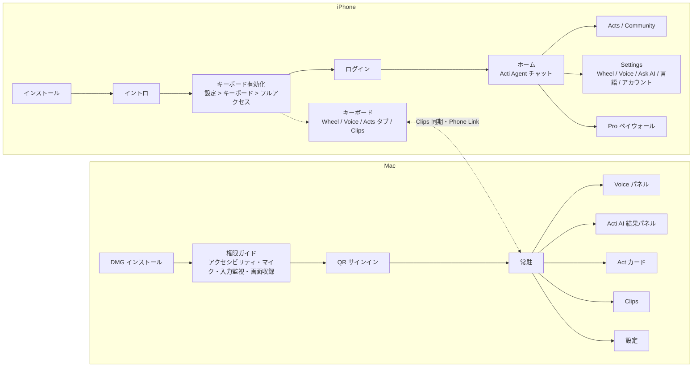

# Acti（エージェントキーボード）調査

- 調査日: 2026-11-09
- 対象: **iPhone のみ**（Mac・Android・Windows は対象外。有料範囲はスキップ — 2026-11-09 ユーザー決定）
- 公式: https://openacti.com/ ・ App Store: https://apps.apple.com/us/app/id6745523677
- 開発: TypeX Limited（シンガポール拠点の Acti。CEO Young Wang は元 Baidu Facemoji Keyboard 責任者）

## 概要・ターゲット
- 一言で: 「Press to type. Hold to act.」 — 普通に打てるキーボードに、AI アクション（Acts）・音声入力・AI 回答を組み込んだ「エージェントキーボード」
- 主なユーザー: アプリを切り替えずに翻訳・文章修正・会議リンク作成などを済ませたいスマホ／Mac のヘビーユーザー
- 主要ユースケース: 入力欄の文章を Act で書き換え／翻訳、音声で入力・翻訳、入力欄の中で AI に質問、クリップボードやスニペットの再利用、スマホとデスクトップ間の連携
- 主な AI 基盤: Google Gemini（TechCrunch）

## 料金プラン
| プラン | 価格 | 主な内容・制限 | 根拠 |
|---|---|---|---|
| Free | 無料 | 通常のタイピングと音声の文字起こしは無料。AI アクションは **1日10クレジット** | [Getting started: Keyboard](https://openacti.com/blog/getting-started-acti-keyboard/), [Voice](https://openacti.com/blog/getting-started-acti-voice/) |
| Acti Pro 月額 | $9.99 | 上限の拡大・上位モデル。**デスクトップ版（Mac）は Pro 必須** | [App Store](https://apps.apple.com/us/app/id6745523677), [Desktop](https://openacti.com/desktop/) |
| Acti Pro 年額 | $94.99 | 同上 | App Store |
| AppSumo 買い切り | $59〜$399 | 月 1,000〜30,000 クレジット | [AppSumo](https://appsumo.com/products/acti/) |

## 機能一覧
| # | 機能 | 区分 | 画面・入口 | 根拠 |
|---|---|---|---|---|
| F01 | キーボード基本入力（43言語・二言語キーボード・ベトナム語 Telex 等） | 無料 | 全アプリの入力欄 | App Store |
| F02 | スペースバーのスワイプでカーソル移動 | 無料 | キーボード | Wheel ガイド |
| F03 | **Acti Wheel**: スペース長押し → 半円5スロットからドラッグして選択（中央は Ask AI） | 無料（AI 実行はクレジット消費） | キーボード | Wheel ガイド |
| F04 | Wheel スロットの編集（My Acts / Acti Tools タブ。Tools は Clipboard・Voice） | 無料 | アプリ > Settings > Wheel | Wheel ガイド |
| F05 | **Acti AI / Ask AI**: 入力欄の中で回答・文章生成 | 無料（クレジット） | Wheel 中央・音声 | App Store |
| F06 | **Acts**: 入力欄の文章／クリップボードに対してワークフロー実行。結果 HUD で Replace / Copy / Append | 無料（クレジット） | キーボードの Acts タブ（Act Panel）・Wheel・割り当てキーの長押し | Acts ガイド |
| F07 | Act をアルファベットキーに割り当て（Act 詳細の右上 +） | 無料 | Act 詳細 | Acts ガイド |
| F08 | **Acti Agent**: アプリのメイン画面のチャットで Act を自然言語から作成・修正・テスト・保存 | 無料 | アプリのホーム | [Acti Agent](https://openacti.com/acti-agent/) |
| F09 | 連携アプリ（Gmail・Slack・Notion・Google Meet・Calendar 等）を OAuth で接続 | 無料と推定 | Act 作成時 | Product Hunt |
| F10 | **Community**: Act の閲覧・インストール・リミックス・公開/非公開 | 無料 | アプリ | Acts ガイド |
| F11 | **Voice**: マイク → Transcribe（無料）／Ask AI。「Translate to」、絵文字トグル | 文字起こし無料／Ask AI はクレジット | キーボードのツールバー | Voice ガイド |
| F12 | Voice 設定: 整形レベル Raw / Clean / Smart（+Custom）、Dictation with Emoji、Enhanced Command Mode | 無料 | アプリの設定 | Voice ガイド |
| F13 | **Clips**: クリップボード履歴・スニペット（カテゴリ・ピン留め・検索・略語展開）。デスクトップと同期 | 無料（同期先の Mac は Pro） | キーボード・アプリ | Desktop |
| F14 | Phone Mic / Phone Link: スマホに話すと Mac に入力される | **有料（Mac 側が Pro）** | アプリ・Mac | Desktop |
| F15 | ログイン／アカウント・クレジット表示 | 無料 | アプリ | Keyboard ガイド |
| F16 | Pro ペイウォール・購入 | 表示は無料／購入は有料 | アプリ | App Store |
| D01 | **Mac: Voice**（Fn 長押しで録音、もう一度 Fn で確定、Esc で取消、履歴100件、15分間の結果保持） | **有料** | グローバル | Desktop |
| D02 | Mac: 音声で Ask AI（Fn+⌘）／テキストで Acti AI（⌥Space）→ 結果パネル（Copy / Insert / Save to Clips） | **有料** | グローバル | Desktop |
| D03 | Mac: Act 実行（⌥A。選択範囲・入力欄・クリップボード・入力テキスト。置換・追記・プレビュー） | **有料** | グローバル | Desktop |
| D04 | Mac: 画面キャプチャから文字取得（⌥⇧A。画像・PDF も可） | **有料** | グローバル | Desktop |
| D05 | Mac: Clips（⌥Enter で略語展開、⌃⌥Space でスニペット選択） | **有料** | グローバル | Desktop |
| D06 | Mac: QR コードでサインイン、1分のセットアップガイド、権限の一括修正、ログイン時起動、自動更新、ライト/ダーク、20言語 | **有料**（インストールとサインイン画面までは無料で見られる可能性あり） | アプリ | Desktop |

## 全体フロー

## 技術スタックの推察
| レイヤ | 推察 | 根拠 | 確度 |
|---|---|---|---|
| iOS キーボード | ネイティブ（Swift / UIKit）のキーボード拡張 | キーボード拡張はメモリ上限が厳しく Flutter / RN は不向き。チームは Facemoji（ネイティブ）出身。二言語・Telex などの入力エンジンを独自実装 | 中 |
| iOS 本体アプリ | Swift（SwiftUI 中心）と推定。Flutter の可能性も残る | アプリサイズ 158.8MB、iOS 17 以上、VoiceOver・ダークモード対応。決め手になる公開情報なし | 低 |
| Mac アプリ | ネイティブ Swift（SwiftUI + AppKit） | macOS 14 以上・ユニバーサル、Fn キー単独のホットキー（CGEventTap が必要）、カーソル位置への挿入（Accessibility API）、画面からの文字取得（Vision / ScreenCaptureKit）。Electron ではないと推定 | 中 |
| AI | Google Gemini（サーバー経由） | TechCrunch | 高 |
| 連携 | サーバー側 OAuth（Gmail・Slack・Notion・Google 等） | Product Hunt の開発者コメント | 中 |
| 公式サイト | Next.js（App Router）+ Tailwind CSS、Google Cloud でホスト | `_next/static/chunks`、Tailwind の任意値クラス（`bg-[#eef2f7]`）、`via: 1.1 google` | 高 |

## 再現に使うスタック（決定）
- 採用:
  - **iPhone**: Swift / SwiftUI（本体アプリ）+ UIKit（Keyboard Extension）。App Group で設定・Clips・Acts を共有
  - **共通コード**: Swift Package（デザイントークン・モデル・モック AI クライアント）。本体アプリとキーボード拡張で共有
  - （Mac 版はスコープ外。将来やる場合は SwiftUI + AppKit で同じ Package を再利用できる）
  - **バックエンド**: 自前のモックサーバー（ローカル）。AI 応答・OAuth 連携・Community はモックデータで再現。必要なら後から実 LLM に差し替える
- Pro 限定の機能は再現しない。ペイウォールは「表示のみ」を再現し、購入処理はモックにする
- 理由: 推察どおりネイティブが最も忠実に再現できる。キーボード拡張はネイティブ API でしか実現できない
- 推察との差分と影響: 本体アプリが実は Flutter だった場合も、見た目とインタラクションは SwiftUI で再現できる。ビルドには Xcode（macOS）が必要なため、**コードの生成と実機での検証はユーザーの Mac 上で行う**（このクラウド環境では Swift のビルドができない）

## 再現時の置き換え（コピーしないもの）
- 「Acti」の名称・ロゴ・アプリアイコン・Halo リングのグラフィック・公式イラスト → 仮名（例: 「Keyact」）と仮アイコン
- 公式の Act 名・Community の投稿・説明文 → ダミーの文言
- 詳細は `assets-todo.md` に列挙する（コード生成時に作成）

## 参照
- [openacti.com](https://openacti.com/) / [Desktop](https://openacti.com/desktop/) / [Acti Agent](https://openacti.com/acti-agent/)
- [Getting started: Keyboard](https://openacti.com/blog/getting-started-acti-keyboard/) / [Wheel](https://openacti.com/blog/getting-started-acti-wheel/) / [Voice](https://openacti.com/blog/getting-started-acti-voice/) / [Acts](https://openacti.com/blog/getting-started-acti-acts/)
- [App Store](https://apps.apple.com/us/app/id6745523677) / [Product Hunt](https://www.producthunt.com/products/acti-2) / [TechCrunch](https://techcrunch.com/2026/06/30/acti-puts-ai-agents-directly-into-your-smartphone-keyboard) / [AppSumo](https://appsumo.com/products/acti/)
